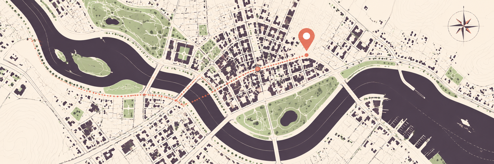

# Laravel Places Scout



A Laravel client for Google Places Text Search and Place Details. Responses are
returned as typed data objects.

[](https://github.com/eloquage/laravel-places-scout/actions/workflows/run-tests.yml)
[](https://packagist.org/packages/illuma-law/laravel-places-scout)
[](LICENSE.md)

Requires PHP 8.3+ and Laravel 11, 12, or 13.

## Install

```bash
composer require illuma-law/laravel-places-scout
php artisan vendor:publish --tag=places-scout-config
```

Set your Google Places API key in `.env`:

```dotenv
GOOGLE_PLACES_API_KEY=your-api-key
```

## Search for places

```php
use IllumaLaw\PlacesScout\Facades\PlacesScout;

$response = PlacesScout::textSearch('coffee shops in Lisbon');

foreach ($response?->results ?? [] as $place) {
    echo $place->name;
    echo $place->formattedAddress;
}
```

## Get place details

```php
$place = PlacesScout::getPlaceDetails('ChIJ...');

if ($place !== null) {
    echo $place->name;
    echo $place->website;
}
```

Both methods return `null` when the Google API request fails. You can pass
`withApiKey($key)` before either method to use a per-request key.

## Tests

```bash
composer test
composer analyse
composer format -- --test
```

## License

MIT. See [LICENSE.md](LICENSE.md).
